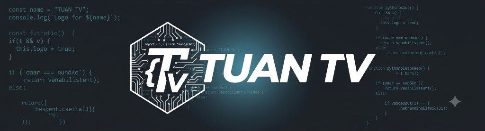

<p align="center">
  <a href="#-combined-contribution-activity">
    
  </a>
</p>

<h3 align="center">Hi, I'm Tran Tuan 👋</h3>

<p align="center">
  
</p>

---

# 🚀 OrbiTasks - Task & Project Management Website

Website hỗ trợ sinh viên và đội nhóm **quản lý dự án, phân công nhiệm vụ và theo dõi tiến độ** một cách trực quan, khoa học và hoàn toàn miễn phí. Dự án được xây dựng trong khuôn khổ môn học **FER202 (Front-End Web Development)** tại Đại học FPT Hà Nội.

---

## 🌟 Các tính năng chính

* **Xác thực & Bảo mật (Auth & Security):** Đăng ký tài khoản, đăng nhập thường, đăng nhập nhanh qua Google (OAuth 2.0), quên/đổi mật khẩu, xác minh reCAPTCHA chống spam bot.
* **Quản lý Hồ sơ cá nhân:** Cập nhật thông tin người dùng, đổi ảnh đại diện (Avatar), đổi mật khẩu cá nhân.
* **Quản lý Dự án (Projects):** Tạo mới, chỉnh sửa, gắn sao yêu thích, tìm kiếm, lọc, lưu trữ (Archive), khôi phục và xoá dự án.
* **Quản lý Thành viên (Team Members):** Mời/xoá thành viên trong dự án, phân quyền, rời dự án.
* **Quản lý Nhiệm vụ (Tasks):** Tạo và giao việc, kéo thả trạng thái Kanban, cập nhật tiến độ, yêu cầu quyền chỉnh sửa task (Request to Edit Task), bình luận và đính kèm tài liệu.
* **Quản lý Nhãn (Labels):** Tạo nhãn màu phân loại công việc (Public / Private).
* **Bản đồ & Định vị (OpenStreetMap):** Hiển thị bản đồ địa chỉ văn phòng, tích hợp tìm kiếm địa điểm và chỉ đường tương tác bằng Leaflet OSM.
* **Dashboard & Thống kê:** Biểu đồ thống kê nhiệm vụ và tiến độ dự án trực quan (Recharts).
* **Tính năng Quản trị viên (Admin):** Quản lý toàn bộ người dùng, dự án hệ thống và trích xuất báo cáo dữ liệu ra file Excel.
* **Tính năng mở rộng:** Tích hợp AI tìm kiếm task/project bằng giọng nói (Voice Search), gợi ý công việc thông minh, hệ thống thông báo thời gian thực và hỗ trợ song ngữ **Anh - Việt (i18n)**.

---

## 🧰 Tech Stack

| Danh mục | Công nghệ & Công cụ sử dụng |
| :--- | :--- |
| 🎨 **Frontend** |       |
| ⚙️ **Backend** |      |
| 🗄️ **Databases** |     |
| 🚀 **DevOps** |      |
| 🧪 **Tools** |     |

---

## ⚙️ Cài đặt & Khởi chạy (Local Development)

### 1. Clone dự án
```bash
git clone https://github.com/TranTuan-ops/task-management-website.git
cd task-management-website
```

### 2. Cài đặt thư viện dependencies
```bash
npm install --legacy-peer-deps
```

### 3. Cấu hình biến môi trường (.env)
Tạo file `.env` ở thư mục gốc (hoặc copy từ `.env.example`):
```env
VITE_PORT=5173
VITE_API_URL=http://localhost:9999
```

### 4. Khởi chạy Mock Backend (JSON Server)
Mở một cửa sổ Terminal và chạy:
```bash
npx json-server --watch database.json --port 9999
```
*API mock sẽ hoạt động tại:* `http://localhost:9999`

### 5. Khởi chạy Frontend
Mở một cửa sổ Terminal thứ hai và chạy:
```bash
npm run dev
```
*Truy cập website tại:* [http://localhost:5173](http://localhost:5173)

---

## 📂 Cấu trúc thư mục

```text
task-management-website/
├── assets/                 # Hình ảnh banner và dashboard cho tài liệu
├── public/                 # Assets tĩnh (icon, logo, hình ảnh web)
├── src/
│   ├── assets/             # Hình ảnh, video, lottie animation
│   ├── banner/             # Component banner giao diện
│   ├── constants/          # Hằng số hệ thống (API URL, Roles, Routes)
│   ├── context/            # Quản lý Context API (Auth, State)
│   ├── layouts/            # Layout bố cục (PreLoginLayout, PostLoginLayout)
│   ├── locales/            # Cấu hình đa ngôn ngữ i18n (en, vi)
│   ├── mapOSM/             # Component Bản đồ tương tác Leaflet OpenStreetMap
│   ├── pages/              # Giao diện các trang (Admin, Guest, User)
│   ├── routes/             # Cấu hình React Router
│   ├── security/           # Logic xác minh & bảo mật
│   └── services/           # Gọi API & xử lý dữ liệu dịch vụ
├── database.json           # Cơ sở dữ liệu mẫu cho JSON Server
├── .env.example            # Mẫu biến môi trường
└── package.json            # Danh sách thư viện và cấu hình scripts
```

---

## 👥 Thành viên dự án & Đóng góp

* **Phuong Anh**
* **Tran Tuan:**
  * **Auth & Onboarding:** Code UI Signup, tích hợp đăng nhập bằng Google (Google Login OAuth).
  * **Quản lý nhiệm vụ (Tasks):** Code UI Update Task, Code UI Request to edit task for member being assigned tasks.
  * **Dashboard & Báo cáo:** Code UI User Overview Dashboard for Admin, Code UI Task Overview & Task Dashboard inside owner's project for user.
  * **Tính năng nâng cao & AI:** Tích hợp đa ngôn ngữ (i18n) chuyển đổi giao diện Anh - Việt, tích hợp AI tìm kiếm task & project bằng giọng nói (Voice Search AI).
* **Hoang**
* **Manh**
* **Phu**
* **Bui Duong**

---

## 📊 Combined Contribution Activity

<div align="center" id="contribution-dashboard">
  <a href="https://github.com/TranTuan-ops">
    
  </a>
  <p><i>Daily activity aggregated from GitHub and GitLab &bull; Automatically updated by GitHub Actions</i></p>
</div>


<h3 align="center">🐍 My GitHub Contributions</h3>

<p align="center">
  
</p>
